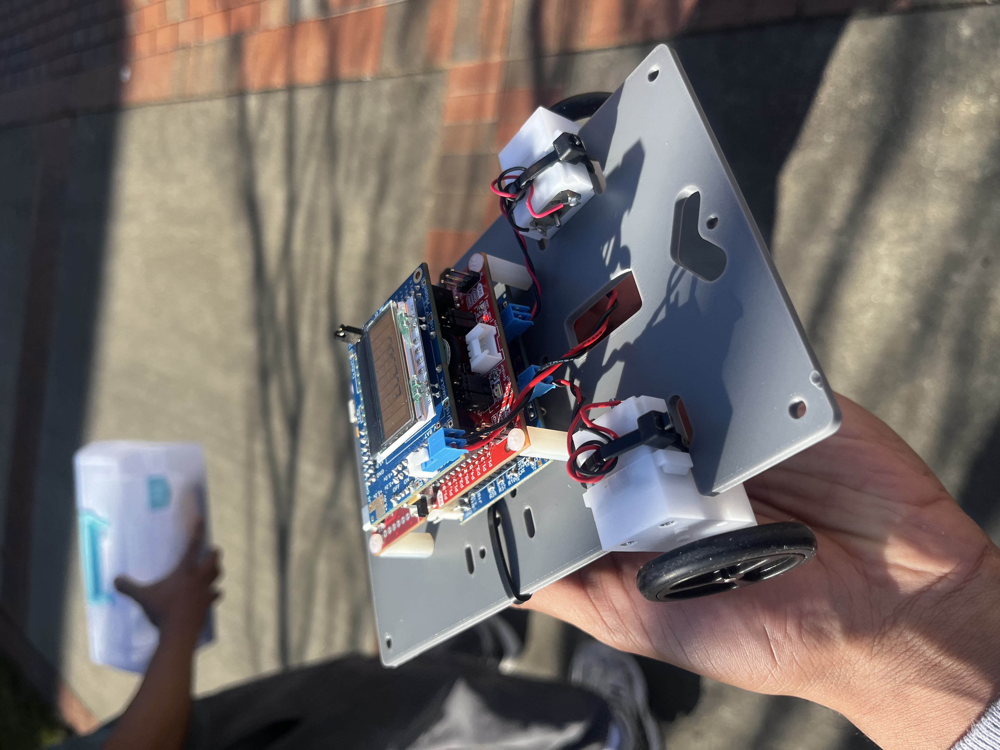
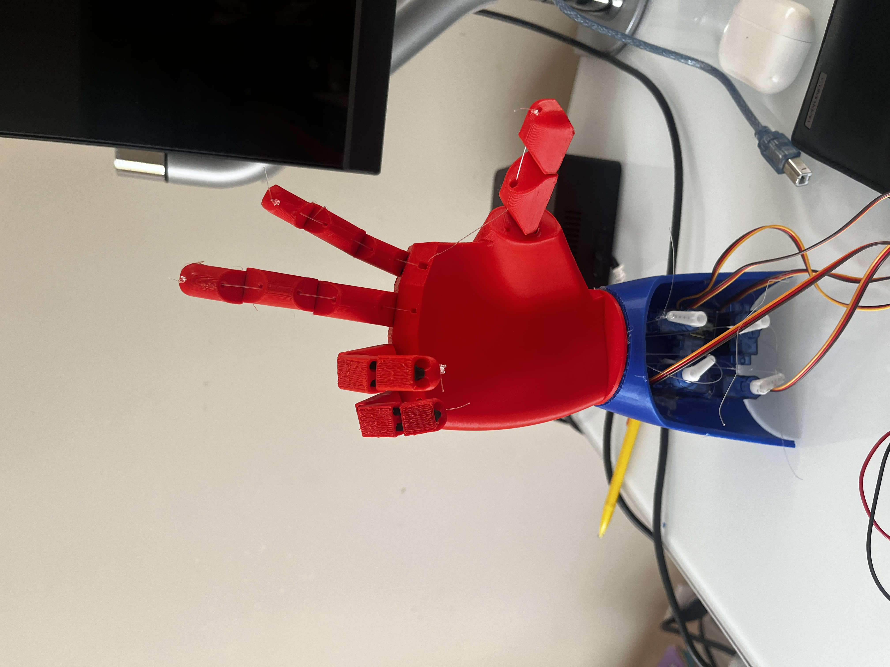

# Autonomous WiFi-Controlled Car

MSP430FR2355-based car that navigates a physical course on its own using IR sensors and bang-bang motor control, with wireless command-and-control over TCP/IP via an ESP8266 WiFi module.

Built for ECE 306 at NC State. The car runs a finite state machine and can switch between autonomous line-following mode and WiFi-commanded mode on the fly.




## How it works

Two IR reflectance sensors read the line on the course. A bang-bang controller adjusts PWM duty cycle in real time based on which sensor sees black vs white, keeping the car on course. The ESP8266 bridges TCP/IP commands to the MSP430 over UART at 115200 baud so the car can also be controlled wirelessly from a laptop.

The finite state machine handles discrete navigation states including forward, turn left, turn right, stop, and line-follow, with deterministic transitions based on the sensor inputs.

## Hardware

- MSP430FR2355 LaunchPad
- ESP8266-01 WiFi module
- 2x IR reflectance sensors
- DC motors with H-bridge driver
- 16x2 LCD (SPI)

## Wiring

```
ESP8266 TX -> MSP430 UART RX (A1)
ESP8266 RX -> MSP430 UART TX (A1)
IR sensors -> MSP430 ADC (A2, A3)
Motors     -> H-bridge -> GPIO
LCD        -> SPI (UCB0)
```

## Build

Open in Code Composer Studio, select MSP430FR2355 target, build and flash via USB.

Default baud is 115200. IR calibration values are in `macros.h` and you will need to tune the BLACK and WHITE thresholds for your specific floor surface.

## File overview

| File | What it does |
|---|---|
| `main.c` | Entry point, FSM event loop |
| `movemnt.c` | Navigation states, motor control, IR logic |
| `serial.c` | UART drivers, ESP8266 WiFi bridge, ring buffers |
| `adc.c` | IR sensor ADC sampling |
| `dac.c` | Emitter drive intensity control |
| `timers.c` | Timer config, PWM |
| `ports.c` | GPIO init |
| `macros.h` | All tunable constants |

## Performance

- Command-to-actuation latency over WiFi: under 100ms
- IR sensor sampling: interrupt-driven via Timer_A

## Known issues

The ESP8266 occasionally needs a manual reset after power-on if it does not auto-join. The Init_IOT() sequence in serial.c handles most cases but the timing can be fussy. At higher speeds the bang-bang controller oscillates slightly on tight turns, reducing SPEED_FAST in macros.h helps.
